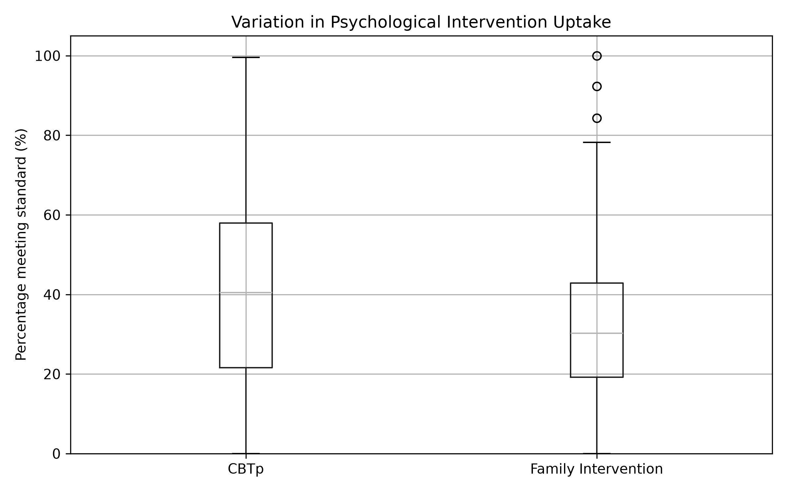
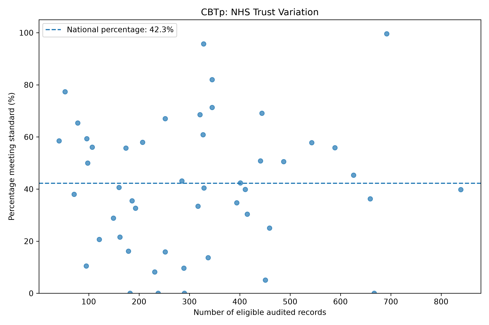
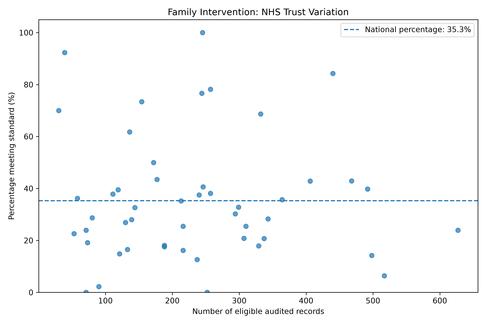

# Investigating Variation in Psychological Intervention Access for Early Psychosis in England

## Project Overview

This independent Health Data Science project investigates variation in recorded achievement of psychological intervention standards across NHS trusts in England.

Drawing on my background in Mental Health Nursing, I developed this project to apply Python and statistical analysis to real healthcare data.

## Research Question

How does recorded achievement of CBTp and family intervention standards vary across NHS trusts in England?

## Methodology

### 1. Research Design

This project employed a quantitative, observational research design using secondary analysis of publicly available NHS audit data.

The analysis aimed to investigate variation in recorded achievement of psychological intervention standards across NHS trusts in England. An exploratory approach was adopted to identify patterns in the data without making causal assumptions about service delivery or patient outcomes.

### 2. Data Source and Selection

Data were obtained from the 2026 National Clinical Audit of Psychosis (NCAP), using the England dataset derived from the Mental Health Services Data Set (MHSDS).

The analysis included 49 NHS trusts delivering Early Intervention in Psychosis services.

Two indicators were selected:

- Indicator 2.1: Cognitive Behavioural Therapy for Psychosis (CBTp).
- Indicator 2.3: Family intervention.

For each indicator, the dataset provided numerators, denominators and reported percentages. These variables formed the basis of the statistical analysis.

### 3. Data Preparation and Cleaning

Python and Pandas were used to import, inspect and prepare the Excel dataset.

The following procedures were performed:

1. Imported the workbook using `pd.read_excel()` with the appropriate header row.
2. Identified NHS trust records using organisation identifiers.
3. Excluded the national summary row to prevent double counting.
4. Selected the relevant intervention indicators.
5. Converted the selected numerical variables into appropriate data types.
6. Checked for duplicate NHS trust identifiers, missing values and invalid numerical records.

Data validation identified no duplicate trust identifiers, missing intervention values or invalid numerator and denominator records within the selected indicators.

### 4. Descriptive Statistical Analysis

Descriptive statistics were calculated using Pandas to examine variation in recorded intervention percentages.

Measures included the mean, median, standard deviation, minimum, maximum and quartiles.

The unweighted mean represented the average reported percentage across individual NHS trusts.

National percentages were calculated separately by dividing the total number of records meeting each audit standard by the corresponding total number of eligible records.

This distinction was important because NHS trusts contributed different numbers of eligible records.

### 5. Correlation Analysis

Pearson and Spearman correlation coefficients were calculated to investigate potential associations between the number of eligible audited records and the percentage meeting each intervention standard.

Pearson correlation was used to explore linear relationships, while Spearman correlation was used to examine monotonic relationships based on ranked values.

These analyses were exploratory. Eligible audited record counts were not assumed to represent overall service size, and the correlation findings were not interpreted as evidence of causation.

An additional limitation was that the denominators used as explanatory variables also contributed to calculating the intervention percentages.

### 6. NHS Trust Comparisons

Trust level intervention percentages were calculated using the corresponding numerators and denominators.

Organisations were ranked to identify the five highest and five lowest recorded percentages for each intervention.

The corresponding numerators and denominators were retained to support interpretation of the results and avoid relying on percentages alone.

These comparisons were descriptive and were not intended to establish organisational performance rankings.

### 7. Sensitivity Analysis

A sensitivity analysis was conducted to investigate whether extreme recorded percentages persisted after excluding organisations with small denominators.

The analysis was repeated using only NHS trusts with at least 100 eligible audited records.

The threshold of 100 was selected for exploratory purposes and was not an official NCAP reporting requirement.

This approach helped determine whether extreme recorded percentages were confined to organisations with relatively small numbers of eligible records.

### 8. Data Validation

Calculated intervention percentages were compared with the percentages provided in the original dataset.

A difference greater than 0.1 percentage points was treated as a mismatch.

No mismatches exceeding this tolerance were identified for either intervention.

Additional checks confirmed that numerators did not exceed denominators and that valid denominators were positive.

These procedures supported the internal consistency of the analysis but could not establish the completeness or accuracy of the underlying clinical records.

### 9. Data Visualisation

Matplotlib was used to produce graphical representations of the findings.

Box plots illustrated the distribution of reported intervention percentages across NHS trusts.

Scatter plots were used to explore associations between eligible audited record counts and intervention percentages. Horizontal reference lines represented the corresponding national percentages.

Visualisations were saved as PNG files to support reproducibility and communication of findings.

### 10. Methodological Limitations

The analysis was limited to aggregated NHS trust data rather than individual patient records.

Consequently, potential influences such as patient characteristics, clinical eligibility, treatment preferences and organisational practices could not be investigated directly.

Furthermore, recorded achievement of audit standards may not fully reflect the care delivered, particularly where clinical documentation is incomplete.

The research therefore focused on identifying and describing variation rather than establishing the causes of observed differences.

## Visualisations

### 1. Variation in Psychological Intervention Uptake

### 2. CBTp Across NHS Trusts

### 3. Family Intervention Across NHS Trusts

