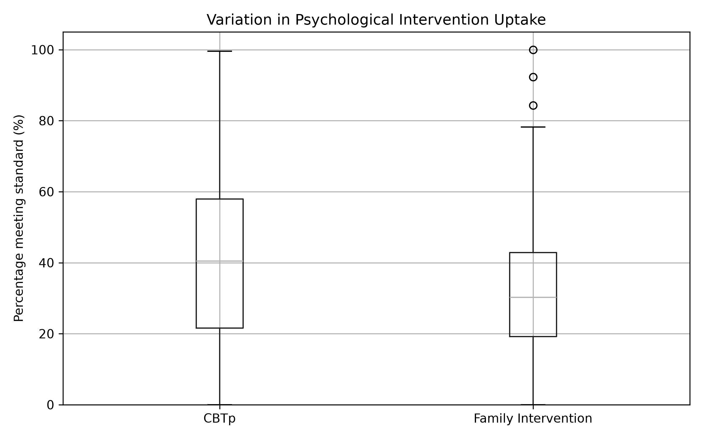
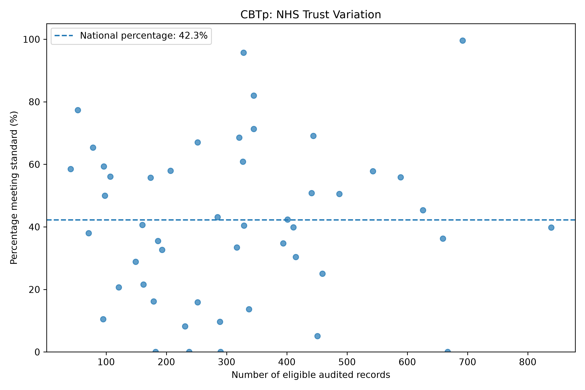
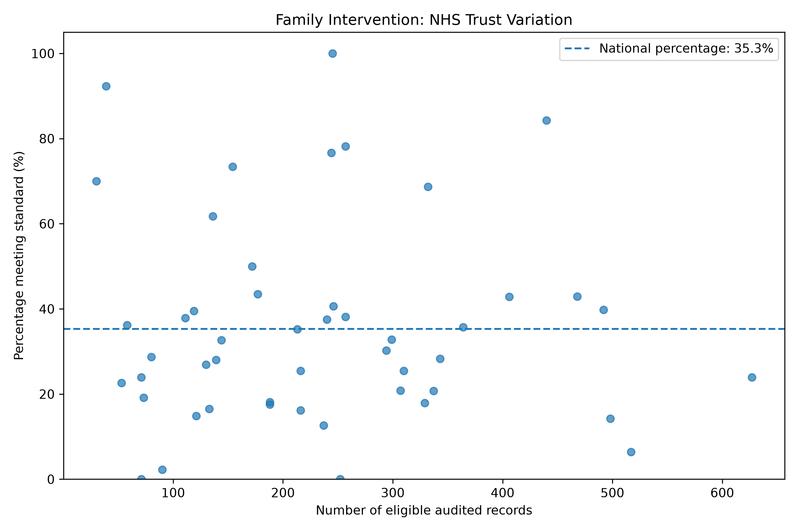

# Investigating Variation in Psychological Intervention Uptake Across Early Intervention in Psychosis Services in England

*An independent Health Data Science research project*

**Dataset:** National Clinical Audit of Psychosis (NCAP), England 2026  
**Analysis tools:** Python, Pandas, SciPy, Matplotlib and OpenPyXL  
**Research status:** Initial analysis complete; independent secondary analysis

## Abstract

**Background:** Cognitive Behavioural Therapy for Psychosis (CBTp) and family intervention are important components of care for people experiencing first episode psychosis. Routinely collected audit data can reveal differences in recorded intervention uptake across healthcare organisations, although reporting quality may affect interpretation.

**Aim:** To describe variation in recorded achievement of CBTp and family intervention standards across NHS trusts in England and explore whether that variation was associated with the number of eligible audited records.

**Methods:** Publicly available aggregated data from the 2026 National Clinical Audit of Psychosis were analysed for 49 NHS trusts. Descriptive statistics, pooled national percentages, Pearson and Spearman correlations, trust comparisons, a denominator sensitivity analysis and internal consistency checks were completed using Python.

**Results:** The pooled national percentages were 42.26% (6,489/15,356) for CBTp and 35.32% (4,049/11,463) for family intervention. Trust percentages ranged from 0% to 99.57% for CBTp and from 0% to 100% for family intervention. Associations between eligible audited record counts and intervention percentages were close to zero in this unadjusted analysis. Extreme recorded percentages remained after excluding trusts with fewer than 100 eligible records. The selected variables passed the internal numerical checks performed.

**Conclusion:** Considerable variation was observed in recorded achievement of psychological intervention standards. These findings identify patterns worthy of further investigation, but do not demonstrate the causes of variation or establish differences in the quality of treatment delivered.

## 1. Introduction

Early Intervention in Psychosis (EIP) services support people experiencing first episode psychosis (FEP) and those with at-risk mental states (ARMS). The National Clinical Audit of Psychosis (NCAP) evaluates aspects of EIP care against established standards, including access to psychological interventions, family support and physical healthcare (Royal College of Psychiatrists, 2026).

CBTp and family intervention are important measures within this audit. The NCAP methodology defines uptake as receiving at least one session of the relevant intervention. The family intervention standard applies to people with FEP who have a contactable caregiver; this eligibility requirement differs from the CBTp denominator (Royal College of Psychiatrists, 2025).

An international systematic review by Burgess-Barr et al. (2023) found substantial variation in receipt of recommended psychological therapies for psychosis across settings and studies. Its authors highlighted differences in study populations and measurement approaches, underscoring the need for caution when interpreting apparent differences in uptake.

In England, the NCAP moved from bespoke audit submissions to data extracted from the Mental Health Services Data Set (MHSDS) in 2025. Although routine data support broader and more timely monitoring, incomplete recording and data flows may influence apparent achievement of audit standards (Royal College of Psychiatrists, 2026).

This project applies quantitative analysis to the publicly released 2026 England trust-level dataset. It explores variation in recorded intervention uptake and considers how denominators, data validation and limitations of routinely collected data affect interpretation.

## 2. Research Aim and Objectives

**Research aim:** To investigate variation in recorded achievement of CBTp and family intervention standards across NHS trusts in England using the 2026 NCAP dataset.

The objectives were to:

1. Describe the distribution of recorded intervention percentages across NHS trusts.
2. Compare unweighted trust averages with national percentages calculated from pooled numerators and denominators.
3. Explore associations between eligible audited record counts and reported intervention percentages.
4. Identify trusts at the extremes of the recorded distributions while retaining their denominators for context.
5. Assess whether extreme values remain after excluding trusts with fewer than 100 eligible audited records.
6. Check the internal consistency of the selected variables and interpret the results in the context of NCAP reporting limitations.

## 3. Methodology

### 3.1 Study design and unit of analysis

This was a quantitative, cross-sectional, observational secondary analysis of publicly available aggregate audit data. The unit of analysis was the **NHS trust**, not the individual patient or EIP team. No causal relationships were assessed.

### 3.2 Data source and study population

The dataset was the **England 2026** workbook published with the NCAP State of the Nation Report 2026. The English audit draws on the MHSDS; its latest extraction relates to the February 2026 performance month, with reporting covering March 2023 to February 2026 (Healthcare Quality Improvement Partnership, 2026; Royal College of Psychiatrists, 2026).

The published English cohort comprised **15,370 people from 149 EIP teams across 49 NHS trusts**. According to the audit report, the cohort included people aged 14 to 65 with suspected FEP or ARMS who had been on an EIP caseload for at least one year. This is the wider cohort; the intervention-specific denominators differ according to the individual standards.

### 3.3 Outcome definitions

Two NCAP indicators were selected:

- **CBTp (indicator 2.1):** Recorded uptake of at least one CBTp session among eligible people with FEP.
- **Family intervention (indicator 2.3):** Recorded uptake of at least one family intervention session among eligible people with FEP who have a contactable caregiver.

A key methodological consideration is that the MHSDS does not directly capture whether a person has a contactable caregiver. The NCAP methodology published in 2025 therefore specifies an **England proxy denominator** that assumes 74.8% of people with FEP have a contactable caregiver, based on previous audit samples (Royal College of Psychiatrists, 2025). This documented approach is an important limitation when comparing the family intervention percentage with CBTp or interpreting differences between trusts. The precise implementation for the supplied 2026 workbook should be understood in conjunction with the relevant NCAP metric guidance.

The analysis used the workbook's trust-level columns headed `2.1 Numerator`, `2.1 Denominator`, `2.1 Percentage standard met`, `2.3 Numerator`, `2.3 Denominator` and `2.3 Percentage standard met`.

### 3.4 Data import and preparation

Python and Pandas were used to import the Excel workbook with `header=1`, reflecting the workbook's header layout. Trust records were identified using organisation IDs matching the pattern `ORG` followed by digits. This excluded the national summary row from the trust-level analysis and prevented double counting.

Numerators, denominators and reported percentages were converted to numeric values. For each indicator, valid analytical records were defined as having non-missing values, a positive denominator and a numerator between zero and the denominator.

### 3.5 Descriptive analysis

Means, medians, standard deviations, first and third quartiles, minima and maxima were calculated across the 49 trusts using the workbook's reported percentages. Each trust contributed equally to these descriptive summaries.

National percentages were calculated separately by pooling trust-level numerators and denominators:

**National percentage = (sum of valid numerators ÷ sum of corresponding denominators) × 100.**

Unlike the simple trust average, the pooled figure gives more weight to trusts with larger relevant denominators. Because the indicators have different eligibility rules, their pooled percentages do not represent identical populations.

### 3.6 Exploratory correlation analysis

For each intervention, the trust's numerator was divided by its denominator to calculate a percentage. Pearson's *r* was then used to describe linear association between the number of eligible audited records and that percentage; Spearman's rank correlation (*ρ*) was used to explore monotonic association.

These were **unadjusted, descriptive correlations** across 49 organisations. The denominator is also part of the percentage calculation, which may affect the statistical relationship. In addition, the number of eligible audited records is not equivalent to a separately measured service caseload or workforce capacity. The analysis did not adjust for patient demographics, case mix or organisational characteristics, and no formal significance testing was undertaken.

### 3.7 Trust comparisons and denominator sensitivity analysis

Trusts were ranked separately for each intervention to identify the five highest and five lowest recorded percentages. Numerators and denominators were retained alongside the percentages to provide context.

A sensitivity analysis repeated the assessment of extreme percentages after restricting the dataset to trusts with at least **100 eligible audited records**. This was an exploratory threshold selected for this project, not a formal NCAP exclusion rule. The purpose was to check whether the most extreme observed values were confined to small denominators.

### 3.8 Data validation and visualisation

Data checks covered duplicate organisation IDs, missing numerators and denominators, invalid numerator/denominator relationships and agreement between calculated and published percentages. A discrepancy greater than **0.1 percentage points** was classified as a mismatch. Passing these checks supports computational consistency, but does not validate the completeness or accuracy of the original clinical recording.

Matplotlib was used to produce a comparative box plot and separate scatter plots for CBTp and family intervention. The scatter plots display the respective national percentage as a reference line. CSV files containing trust-level results were exported to support reproducibility.

### 3.9 Ethical and analytical considerations

Only publicly available aggregate data were analysed. No individual patient records were accessed. The findings are intended for exploratory service-level research and should not be used to rank the clinical quality of individual trusts without additional contextual information and data-quality assessment.

## 4. Results

### 4.1 Descriptive statistics

The analysis included 49 NHS trusts for each indicator.

| Statistic | CBTp (%) | Family intervention (%) |
|---|---:|---:|
| Count | 49 | 49 |
| Mean | 41.18 | 35.75 |
| Median | 40.43 | 30.27 |
| Standard deviation | 25.11 | 23.85 |
| Minimum | 0.00 | 0.00 |
| First quartile | 21.60 | 19.18 |
| Third quartile | 57.97 | 42.86 |
| Maximum | 99.57 | 100.00 |

The trust-level mean was higher for CBTp than for family intervention, but both distributions showed substantial dispersion. The standard deviations were **25.11** and **23.85 percentage points**, respectively. These summary statistics describe observed variation; they do not determine its clinical or organisational causes.

*Figure 1. Distribution of recorded CBTp and family intervention percentages across 49 NHS trusts.*

### 4.2 Pooled national percentages

| Indicator | Numerator | Denominator | Pooled national percentage |
|---|---:|---:|---:|
| CBTp | 6,489 | 15,356 | 42.26% |
| Family intervention | 4,049 | 11,463 | 35.32% |

These pooled percentages differed slightly from the simple trust averages of **41.18%** and **35.75%**. This reflects the differing contributions of trusts with larger and smaller indicator denominators. The family intervention denominator also has a distinct eligibility definition, including the documented use of a proxy measure in England.

### 4.3 Associations with eligible audited record counts

| Intervention | Pearson's *r* | Spearman's *ρ* | Trusts analysed |
|---|---:|---:|---:|
| CBTp | 0.073 | 0.039 | 49 |
| Family intervention | −0.031 | 0.028 | 49 |

All four coefficients were near zero, indicating little **observed linear or monotonic association** in these unadjusted comparisons. This does not demonstrate the absence of a relationship with overall service caseload or capacity.

*Figure 2. Eligible audited records and recorded CBTp percentages across NHS trusts.*

*Figure 3. Eligible audited records and recorded family intervention percentages across NHS trusts.*

### 4.4 Variation between individual trusts

For CBTp, **ORG24** had the highest recorded percentage at **99.57% (689/692)**, followed by **ORG27** at **95.73% (314/328)**. Four trusts recorded 0%, including **ORG53 (0/667)**.

For family intervention, **ORG27** recorded **100% (245/245)**, followed by **ORG35** at **92.31% (36/39)**. Two trusts recorded 0%: **ORG36 (0/71)** and **ORG64 (0/252)**.

A notable within-trust contrast was observed for **ORG24**: **99.57% (689/692)** for CBTp compared with **6.38% (33/517)** for family intervention. The difference was **93.19 percentage points**. Because these standards have different eligibility definitions and the family intervention denominator may rely on a proxy, this is a descriptive contrast rather than a direct measure of treatment disparity or quality.

### 4.5 Denominator sensitivity analysis

| Result | CBTp | Family intervention |
|---|---:|---:|
| Trusts with valid records | 49 | 49 |
| Trusts with ≥100 eligible records | 42 | 40 |
| Trusts recording 0% before restriction | 4 | 2 |
| Trusts recording 0% after restriction | 4 | 1 |
| Maximum percentage after restriction | 99.57% | 100.00% |

Extreme recorded percentages persisted when trusts with fewer than 100 eligible audited records were excluded. Small denominators therefore did not fully account for the extremes in this dataset, although the sensitivity analysis cannot rule out recording problems, confounding or differences in eligibility.

### 4.6 Internal data validation

There were **no duplicate NHS trust IDs**. For both indicators, the script identified **zero missing numerators, missing denominators, missing reported percentages, invalid records or percentage mismatches above 0.1 percentage points**.

These checks demonstrate consistency between the selected spreadsheet fields and the calculations implemented in Python. They do not establish that all treatment activity was captured accurately in the MHSDS.

## 5. Discussion

### 5.1 Interpretation of variation

The analysis revealed substantial differences in recorded CBTp and family intervention percentages between the 49 NHS trusts. The persistence of extreme values after applying a minimum denominator of 100 indicates that such variation is not confined to trusts with the smallest eligible groups.

Nevertheless, observed variation must not be equated automatically with variation in delivered care. The 2026 NCAP report notes that lower measured performance may reflect incomplete recording or data flow, rather than an absence of care. This is particularly relevant following the transition to routine MHSDS reporting (Royal College of Psychiatrists, 2026).

### 5.2 Different indicators and the family intervention denominator

The two interventions are related clinically, but their denominators are not interchangeable. CBTp is measured in an eligible FEP population, whereas family intervention depends on the presence of a contactable caregiver. The NCAP methodology describes a proxy assumption used to estimate family intervention eligibility in England because the underlying dataset does not directly capture this information (Royal College of Psychiatrists, 2025).

This makes it inappropriate to interpret the difference between **42.26%** and **35.32%** as a direct comparison of equal patient groups. It also limits interpretation of the striking contrast observed for ORG24.

### 5.3 Understanding the near-zero correlations

The near-zero Pearson and Spearman coefficients suggest that **eligible audited record counts** were not strongly associated with recorded intervention percentages at the trust level in this dataset. They do not support an inference that larger or smaller EIP services deliver equivalent care.

Importantly, the official 2026 NCAP report found that larger **caseloads** were associated with lower delivery of certain interventions, including family intervention, after accounting for patient characteristics; it reported no corresponding association for CBTp (Royal College of Psychiatrists, 2026). This does not necessarily conflict with the current findings. The official analysis used different service measures and adjustment methods, whereas this project examined unadjusted trust-level percentages against indicator-specific eligible record counts. Comparing the two analyses highlights why variable definition, level of aggregation and confounding matter.

### 5.4 Clinical implications and next research steps

NHS England (2024) identifies increasing access to evidence-based psychological therapies and developing suitably trained staff as priorities for services supporting people with severe mental health problems. Workforce and service capacity are therefore plausible subjects for future investigation, but were not measured directly in this project.

The findings show how exploratory analysis can help identify unusual patterns for further scrutiny. Before using the results to inform service improvement, analysts would need to assess documentation completeness, ascertain whether denominator definitions are applied consistently, and incorporate contextual information about workforce capacity, patient needs and treatment preferences.

Future work could investigate patient-level access by age, ethnicity, gender or deprivation, if appropriately governed data became available. Such analysis would be necessary to test specific health-inequality hypotheses rather than inferring inequality from trust-level variation alone. The NCAP report itself recommends reducing unwarranted variation and improving both access and routine data quality (Royal College of Psychiatrists, 2026).

## 6. Limitations

This study has several important limitations. First, it used aggregated trust-level data and cannot account for differences between individual patients, EIP teams or local populations. Second, records meeting an audit standard may be affected by clinical documentation and data submission practices. Third, the family intervention denominator relies on a documented eligibility proxy in England, limiting direct comparisons with CBTp. Fourth, the use of denominator counts as an explanatory variable for percentages calculated from those same denominators introduces a potential mathematical dependency. Fifth, the sensitivity analysis used an arbitrary exploratory threshold and was not a formal outlier or risk-adjustment method.

The study did not perform hypothesis tests, model patient-level factors or assess causation. Descriptive results should not be interpreted as adjusted performance rankings or evidence of the reasons for recorded differences.

## 7. Conclusion

Analysis of the 2026 NCAP England dataset identified considerable variation in recorded achievement of CBTp and family intervention standards across 49 NHS trusts. Pooled national percentages were **42.26% for CBTp** and **35.32% for family intervention**. Unadjusted correlations between eligible audited record counts and recorded intervention percentages were close to zero. Extreme values remained when trusts with fewer than 100 eligible records were excluded, and internal numerical checks found no inconsistencies in the selected fields.

The findings demonstrate the value of reproducible data preparation, visualisation, descriptive statistics and validation in examining healthcare services. Equally, they show why methodological context is essential: distinct eligibility rules, an estimated family intervention denominator and limitations in routine recording constrain the conclusions that can be drawn. Further investigation using more detailed and appropriately adjusted data would be needed to explain the observed differences or assess inequalities in treatment access.

## 8. References

Burgess-Barr, S., Nicholas, E., Venus, B., Singh, N., Nethercott, A., Taylor, G., & Jacobsen, P. (2023). International rates of receipt of psychological therapy for psychosis and schizophrenia: Systematic review and meta-analysis. *International Journal of Mental Health Systems, 17*, Article 8. https://doi.org/10.1186/s13033-023-00576-9

Healthcare Quality Improvement Partnership. (2026). *National Clinical Audit of Psychosis (NCAP) 2026* [Data set]. UK Government. https://www.data.gov.uk/dataset/4764dc2f-31b4-4713-92a9-d54260c0b65c/national-clinical-audit-of-psychosis-ncap-2026

NHS England. (2024, April 22). *Implementation guidance 2024: Psychological therapies for severe mental health problems*. https://www.england.nhs.uk/long-read/implementation-guidance-2024-psychological-therapies-for-severe-mental-health-problems/

Royal College of Psychiatrists. (2025). *NCAP methodology: Sampling guidance and eligibility criteria*. https://www.rcpsych.ac.uk/docs/default-source/improving-care/ccqi/national-clinical-audits/ncap-library/routine-audit-2025/ncap-methodology-2025-v1b149732ea4984245a1693d3d024c3105.pdf

Royal College of Psychiatrists. (2026). *National Clinical Audit of Psychosis (NCAP): State of the Nation Report 2026. Reducing variation and improving access to Early Intervention in Psychosis (EIP) services in England and Wales*. Healthcare Quality Improvement Partnership. https://www.rcpsych.ac.uk/docs/default-source/improving-care/ccqi/national-clinical-audits/ncap-library/ncap-state-of-the-nation-report-2026.pdf

Royal College of Psychiatrists. (n.d.). *Audit resources*. https://www.rcpsych.ac.uk/improving-care/ccqi/national-clinical-audits/national-clinical-audit-of-psychosis/audit-resources
